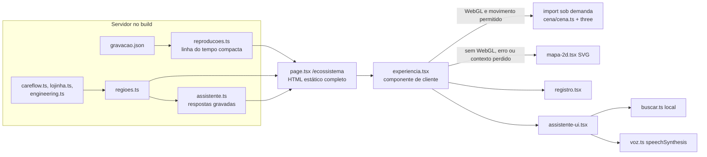

# Plano 0001: Ecossistema em 3D com assistente de respostas gravadas

- Spec: [spec.md](spec.md)
- Data: 2026-11-09

Este plano assume as opções recomendadas das perguntas abertas (respostas gravadas, three.js, só leitura em voz alta). Se o Cleber escolher outra, a spec muda primeiro e este plano depois.

## Contexto técnico

- Next.js 16.4 com App Router e Cache Components; páginas em português no grupo `src/app/(pt)/` ([ADR-0006](../../adr/0006-versao-em-ingles.md)). Componentes de servidor por padrão; carga sob demanda só funciona dentro de componente de cliente (`node_modules/next/dist/docs/01-app/02-guides/lazy-loading.md`).
- CSP sem nonce ([ADR-0003](../../adr/0003-csp-sem-nonce.md)): tudo da própria origem, `connect-src 'self'`, `img-src 'self' blob: data:`, sem `worker-src` próprio. WebGL não precisa de diretiva nova; o three.js não usa `eval` nem `new Function` no núcleo.
- Permissions-Policy atual: `camera=(), microphone=(), geolocation=(), browsing-topics=()` em `src/config/security-headers.ts`.
- Visual "Sala de controle": tokens em `src/app/globals.css`, IBM Plex por `next/font`, componente `Topology` (SVG, pulsos por `offset-path`, escondidos com movimento reduzido).
- Painel do CareFlow: `src/content/painel.ts` (tipos da gravação, `serviceName`, `isDatabaseSpan`, `buildWaterfall`) e `src/content/painel/gravacao.json` (488 KB, gravado pelo CI do careflow, só dados sintéticos). Traces disponíveis: reserva (72 spans), queda do WhatsApp com fallback (81), triagem (42) e revogação do consentimento (324).
- Conteúdo dos projetos já tipado: `careflow.ts` (serviços, fases), `lojinha.ts`, `engineering.ts` (portões do CI), `profile.ts`, `cases.ts`. A base claude-works documenta os agentes (`.claude/agents/`) e o fluxo de uma fase (`agents/fluxo-fase.md`).
- E2E: Playwright em Desktop Chrome e Pixel 7 sobre `next start`, axe nos dois temas e falha com erro de console para toda rota de `staticRoutes` (`e2e/routes.ts`).

## Fatos verificados

Conferidos em 2026-11-09 nesta thread.

| Fato                                                                                                                                                                                            | Fonte                                                                                                               |
| ----------------------------------------------------------------------------------------------------------------------------------------------------------------------------------------------- | ------------------------------------------------------------------------------------------------------------------- |
| three 0.187.0, licença MIT, publicado em 2026-10-30; `@types/three` 0.187.0, MIT                                                                                                                | `npm view three`, `npm view @types/three`                                                                           |
| Cena mínima com three (renderer, pontos, linhas) pesa 538 KB minificada e **133 KB** com gzip; com o pós-processamento de brilho (`UnrealBloomPass`), 136 KB                                    | esbuild 0.25 com `--bundle --minify`, gzip -9                                                                       |
| `@react-three/fiber` 9.8.2 declara `react >=19 <19.4` como peer: prenderia o React do site                                                                                                      | `npm view @react-three/fiber peerDependencies`                                                                      |
| Chromium 153 do Playwright, sem interface, cria contexto WebGL2 por software (SwiftShader) e não tem vozes de síntese                                                                           | script Playwright nesta thread                                                                                      |
| `speechSynthesis` existe em Chrome, Edge, Firefox e Safari; as vozes variam por sistema e chegam pelo evento `voiceschanged`; `SpeechSynthesisVoice.localService` diz se a voz roda no aparelho | [MDN, Web Speech API](https://developer.mozilla.org/docs/Web/API/Web_Speech_API)                                    |
| Reconhecimento de voz no Chrome manda o áudio para um serviço do Google e não existe no Firefox                                                                                                 | [MDN, Using the Web Speech API](https://developer.mozilla.org/docs/Web/API/Web_Speech_API/Using_the_Web_Speech_API) |
| three.js grava a versão em `window.__THREE__` ao carregar                                                                                                                                       | código-fonte do three (`src/Three.Core.js`)                                                                         |

## Desenho

### Arquivos

| Caminho                                        | Papel                                                                                                                                                                                                                                                                       |
| ---------------------------------------------- | --------------------------------------------------------------------------------------------------------------------------------------------------------------------------------------------------------------------------------------------------------------------------- |
| `src/app/(pt)/ecossistema/page.tsx`            | Rota estática (servidor): metadados, monta regiões, reproduções e respostas, renderiza o conteúdo sem JS e a experiência de cliente                                                                                                                                         |
| `src/app/(pt)/ecossistema/opengraph-image.tsx` | Imagem de compartilhamento no padrão das outras páginas                                                                                                                                                                                                                     |
| `src/content/ecossistema/regioes.ts`           | Cinco regiões: id, nome, resumo, estado, stack, links, cor (token) e âncora na cena; números lidos de `careflow.ts`, `lojinha.ts` e `engineering.ts`, nunca copiados                                                                                                        |
| `src/content/ecossistema/reproducoes.ts`       | Só servidor. Converte os traces da gravação em eventos `{ servico, origem, operacao, inicioMs, duracaoMs }`, sem spans de banco (mesma regra do Painel), e define o roteiro "uma fase com agentes" a partir de `agents/fluxo-fase.md`, com o portão de aprovação do Cleber  |
| `src/content/ecossistema/assistente.ts`        | Respostas gravadas: id, perguntas de exemplo, palavras-chave, texto, região, fontes. Números interpolados do conteúdo existente                                                                                                                                             |
| `src/lib/assistente/buscar.ts`                 | Busca local: normaliza (minúsculas, sem acento, sem pontuação), tira palavras vazias, pontua pela sobreposição ponderada de termos e devolve a melhor resposta acima de um limiar, ou nenhuma                                                                               |
| `src/lib/voz.ts`                               | `podeFalar`, `falar`, `parar` sobre `speechSynthesis`: voz pt-BR com preferência por `localService`, cancela ao pausar, desligar ou desmontar                                                                                                                               |
| `src/lib/capacidades.ts`                       | Decide o modo (`3d`, `2d`, `estatico`) por WebGL e `prefers-reduced-motion`                                                                                                                                                                                                 |
| `src/components/ecossistema/experiencia.tsx`   | Cliente. Estado (região, reprodução, pausado, modo), controles, carga sob demanda da cena, troca para 2D em falha                                                                                                                                                           |
| `src/components/ecossistema/cena/cena.ts`      | Único lugar que importa `three`: renderer, pontos do cérebro com brilho aditivo, arcos e pulsos, rotação, seleção por clique (raycast), redimensionamento, suspensão por `visibilitychange` e `IntersectionObserver`, `webglcontextlost` → aviso para cair no 2D, `dispose` |
| `src/components/ecossistema/cena/cerebro.ts`   | Puro e testável sem WebGL: gera os pontos de dois hemisférios com sulcos a partir de semente fixa e atribui cada ponto a uma região                                                                                                                                         |
| `src/components/ecossistema/cena/sinais.ts`    | Puro: arcos entre âncoras e posição de cada pulso no tempo da reprodução                                                                                                                                                                                                    |
| `src/components/ecossistema/mapa-2d.tsx`       | SVG com as mesmas regiões e destaques, sem animação automática                                                                                                                                                                                                              |
| `src/components/ecossistema/registro.tsx`      | Lista das sub-rotinas da reprodução atual (serviço, operação, duração)                                                                                                                                                                                                      |
| `src/components/ecossistema/assistente-ui.tsx` | Perguntas sugeridas, campo de 200 caracteres, aviso de privacidade, digitação que respeita a pausa e o movimento reduzido, região `aria-live` com o texto final, controle de voz                                                                                            |

### Comportamento

- **Progressivo:** o HTML do servidor já é a página inteira em texto (regiões, cartões, reproduções como lista, perguntas em `
`). O JavaScript troca isso pela experiência e baixa a cena só se houver WebGL e movimento permitido.
- **Painel sempre escuro:** a cena fica numa "tela de monitor" escura nos dois temas, porque brilho aditivo some em fundo claro. Tokens novos e fixos em `globals.css` (`--monitor-bg`, `--monitor-fg`, `--monitor-muted`, `--monitor-border` e cinco cores de região da família ciano, verde, âmbar, azul e violeta), com contraste conferido pelo axe nos dois temas. Cor nunca é o único sinal: toda região tem rótulo.
- **Reprodução:** os eventos mantêm ordem e proporção do trace gravado, esticados para durar de 12 a 20 segundos; cada evento acende um pulso do serviço de origem ao de destino e entra no registro. A fase com agentes para no portão "aprovação do Cleber" por dois segundos antes de seguir.
- **Assistente ligado à cena:** a resposta escolhida destaca a região dela e, quando faz sentido, inicia a reprodução relacionada (ex.: pergunta sobre consentimento → revogação).
- **Pausa:** um único estado `pausado` para o laço de animação, os pulsos, o registro, a digitação e a voz.

## Contratos e dados

- URL pública nova: `/ecossistema`, em `staticRoutes` (sitemap e E2E de todas as rotas) e com imagem Open Graph própria.
- Links novos: botão no topo da home em português e em inglês (`home-text.ts`, com "(in Portuguese)" e `hrefLang="pt-BR"`) e cartão em `/projetos`.
- Dependências: `three` em `dependencies` e `@types/three` em `devDependencies`, ambas `^0.187.0` (que em 0.x prende o minor). O workflow do Dependabot passa a tratar `three` como framework, com minor em revisão manual (ADR-0007), porque minor do three costuma quebrar API.
- Sem schema, evento, variável de ambiente nem mudança de CSP ou cabeçalho.

## Segurança

| Ameaça                                     | Mitigação                                                                                                                               | Teste                                                                             |
| ------------------------------------------ | --------------------------------------------------------------------------------------------------------------------------------------- | --------------------------------------------------------------------------------- |
| XSS pelo campo do assistente               | Texto do visitante só vira valor de busca e é exibido como texto pelo React; nenhum `dangerouslySetInnerHTML`; limite de 200 caracteres | Unidade da busca com `<script>` e HTML; componente confere que nada vira elemento |
| Vazamento do que o visitante digita        | Busca local; nenhuma requisição nem `localStorage` no envio                                                                             | E2E escuta a rede e o armazenamento durante o envio (CA-14)                       |
| Biblioteca de terceiro comprometida        | three e tipos com licença MIT, versão travada no lock, revisão de dependências e Dependabot com minor manual                            | CI `Revisão de dependências`, `npm audit`                                         |
| Origem externa ou relaxamento da CSP       | Biblioteca empacotada no build, sem CDN; cabeçalhos da rota iguais aos das outras                                                       | E2E compara cabeçalhos e confere que toda requisição é da própria origem (CA-20)  |
| Texto do visitante enviado para voz remota | A voz lê só respostas gravadas; prefere voz local                                                                                       | Unidade de `voz.ts` com `speechSynthesis` simulado (CA-18)                        |
| Fonte maliciosa ou quebrada numa resposta  | Fontes só rota interna existente ou `https://github.com/cleberSan/`                                                                     | Unidade do conteúdo (CA-16)                                                       |
| Conteúdo fora das regras do site           | Teste barra busca de vaga, e-mail, endereço, "Clean Architecture" e termos de promessa clínica                                          | Unidade do conteúdo e da página (CA-16)                                           |

## Observabilidade

Site estático, sem telemetria nem analytics (decisão vigente). O que falha precisa aparecer para quem visita e para o CI, não num painel:

- WebGL ausente, contexto perdido ou erro ao importar a cena: troca para o mapa 2D e mostra uma linha discreta "mapa em 2D neste navegador", sem `console.error`.
- Os E2E falham em qualquer erro de console, o que pega violação de CSP e exceção não tratada.
- `data-modo` (`3d`, `2d`, `estatico`) e `data-estado` (`animando`, `pausado`) no contêiner da experiência deixam o estado verificável nos testes e no inspetor.

## Testes por critério

| Critério | Teste e tipo                                                                                                                                                                                       | Onde                                                                                                                          |
| -------- | -------------------------------------------------------------------------------------------------------------------------------------------------------------------------------------------------- | ----------------------------------------------------------------------------------------------------------------------------- |
| CA-01    | E2E com JavaScript desligado: regiões, links e perguntas em `
` visíveis                                                                                                                   | `e2e/ecossistema.spec.ts`                                                                                                     |
| CA-02    | Unidade: link na home PT e EN e em `/projetos`; rota em `staticRoutes` e no sitemap                                                                                                                | `src/app/(pt)/page.test.tsx`, `src/app/en/page.test.tsx`, `src/app/(pt)/projetos/page.test.tsx`, `src/app/seo-routes.test.ts` |
| CA-03    | Unidade da página: data e commit da gravação, link do roteiro, nenhum "ao vivo"/"tempo real"                                                                                                       | `src/app/(pt)/ecossistema/page.test.tsx`                                                                                      |
| CA-04    | E2E com movimento permitido: canvas presente, `data-modo="3d"`, `data-estado="animando"`                                                                                                           | `e2e/ecossistema.spec.ts`                                                                                                     |
| CA-05    | Componente: escolher região pela lista destaca e abre o cartão; E2E por teclado                                                                                                                    | `src/components/ecossistema/experiencia.test.tsx`, `e2e/ecossistema.spec.ts`                                                  |
| CA-06    | Unidade: eventos em ordem, proporção preservada, sem spans de banco, duração entre 12 e 20 s; componente: registro lista serviço, operação e duração                                               | `src/content/ecossistema/reproducoes.test.ts`, `src/components/ecossistema/registro.test.tsx`                                 |
| CA-07    | Componente: Pausar para o relógio da reprodução e a digitação; Retomar continua de onde parou                                                                                                      | `src/components/ecossistema/experiencia.test.tsx`                                                                             |
| CA-08    | Unidade de `capacidades.ts`; E2E com `reducedMotion: "reduce"`: sem cena animada, reprodução passo a passo                                                                                         | `src/lib/capacidades.test.ts`, `e2e/ecossistema.spec.ts`                                                                      |
| CA-09    | Componente: falha no import e evento de contexto perdido → mapa 2D; E2E com WebGL bloqueado por script de inicialização, sem erro de console                                                       | `src/components/ecossistema/experiencia.test.tsx`, `e2e/ecossistema.spec.ts`                                                  |
| CA-10    | Unidade da cena com `document.hidden` e `IntersectionObserver` simulados: laço suspenso e retomado                                                                                                 | `src/components/ecossistema/cena/cena.test.ts`                                                                                |
| CA-11    | ESLint `no-restricted-imports` barra `three` fora de `cena/` e import estático de `cena/` fora da experiência; E2E: `window.__THREE__` indefinido em `/` e `/projetos`, definido em `/ecossistema` | `eslint.config.mjs`, `e2e/ecossistema.spec.ts`                                                                                |
| CA-12    | Unidade da busca com tabela pergunta → resposta; componente: pergunta sugerida mostra resposta, fontes e destaca a região                                                                          | `src/lib/assistente/buscar.test.ts`, `src/components/ecossistema/assistente-ui.test.tsx`                                      |
| CA-13    | Unidade: pergunta sem relação devolve nenhuma; componente: mensagem de "sem resposta" e sugestões                                                                                                  | mesmos arquivos                                                                                                               |
| CA-14    | Componente: aviso presente; E2E: nenhuma requisição e nenhum `localStorage` ao enviar                                                                                                              | `assistente-ui.test.tsx`, `e2e/ecossistema.spec.ts`                                                                           |
| CA-15    | Componente: envio vazio ignorado, `maxLength` 200                                                                                                                                                  | `assistente-ui.test.tsx`                                                                                                      |
| CA-16    | Unidade do conteúdo: toda resposta com fonte, fontes permitidas e existentes, textos proibidos ausentes                                                                                            | `src/content/ecossistema/assistente.test.ts`                                                                                  |
| CA-17    | Componente: região `aria-live="polite"` recebe o texto completo uma vez, depois da digitação                                                                                                       | `assistente-ui.test.tsx`                                                                                                      |
| CA-18    | Unidade de `voz.ts` e componente com `speechSynthesis` simulado: desligada no início, lê só a resposta, para ao pausar ou desligar                                                                 | `src/lib/voz.test.ts`, `assistente-ui.test.tsx`                                                                               |
| CA-19    | Componente: sem `speechSynthesis` ou sem voz pt, o controle não aparece                                                                                                                            | `assistente-ui.test.tsx`                                                                                                      |
| CA-20    | E2E: cabeçalhos de `/ecossistema` iguais aos de `/`; toda requisição da própria origem                                                                                                             | `e2e/http.spec.ts`, `e2e/ecossistema.spec.ts`                                                                                 |

Acessibilidade (não funcional): o E2E existente roda axe nos dois temas, no computador e no celular, para toda rota de `staticRoutes`, então a página nova entra sozinha. Somam-se um teste de teclado (Tab passa por regiões, reproduções, Pausar e assistente com foco visível) e a conferência manual com leitor de tela no preview.

Os testes de E2E usam movimento reduzido por padrão e só um teste liga a animação, para não pesar o CI com renderização por software.

## Riscos, entrega e rollback

| Risco                                  | Impacto                | Mitigação                                                                                                                |
| -------------------------------------- | ---------------------- | ------------------------------------------------------------------------------------------------------------------------ |
| Celular fraco engasga                  | Página lenta, bateria  | Pontos por tamanho de tela, densidade de pixels limitada, suspensão fora da tela, 2D como saída; medir no preview        |
| Parecer efeito sem conteúdo            | Desvia do tom do site  | Cada sinal vem de execução gravada ou roteiro documentado, com fonte e rótulo; o Cleber aprova no preview antes do merge |
| Resposta gravada desatualizada         | Informação errada      | Números lidos do conteúdo tipado; fontes conferidas por teste; revisão das respostas no PR                               |
| Gravação inteira indo para o navegador | 488 KB a mais          | Linha do tempo gerada no servidor; teste de tamanho (≤ 40 KB)                                                            |
| Minor do three quebra API              | Build ou cena quebrada | `^0.187.0` prende o minor; Dependabot manual para `three`                                                                |
| CI mais lento                          | Fila maior             | Movimento reduzido por padrão nos E2E; um teste animado                                                                  |
| Marca ou personagem de terceiro        | Problema de imagem     | Nome e visual próprios; nada de referência a franquia                                                                    |

Entrega num PR só (este), uma tarefa por commit, com o preview da Vercel para o Cleber ver e testar antes do merge. Sem ordem de merge com outro repositório. Depois do merge, a base claude-works ganha a rota no cartão do portfolio-web (skill `kb-atualizar`).

Rollback: reverter o PR (a rota é isolada e não muda cabeçalho, variável nem conteúdo existente além dos dois links) ou promover a publicação anterior na Vercel.

## Decisões

ADR-0009 novo (skill `novo-adr`) depois dos cards: cena 3D com three.js carregado só na rota, assistente de respostas gravadas sem modelo ao vivo, voz só de leitura e sem microfone, painel sempre escuro. Segue o ADR-0003 (nenhuma mudança de CSP) e o ADR-0006 (página só em português).
